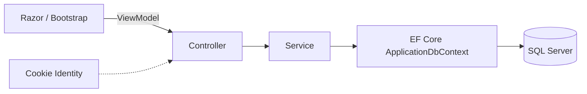
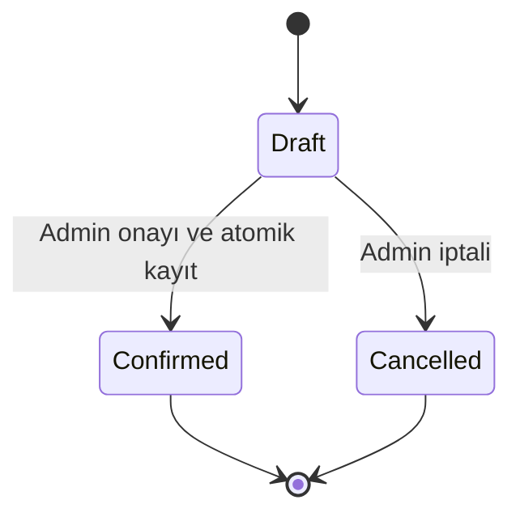
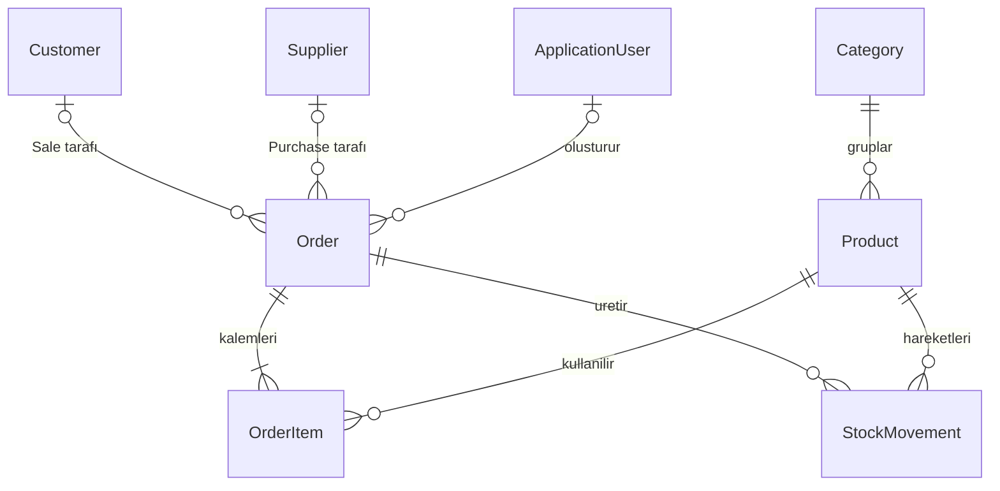
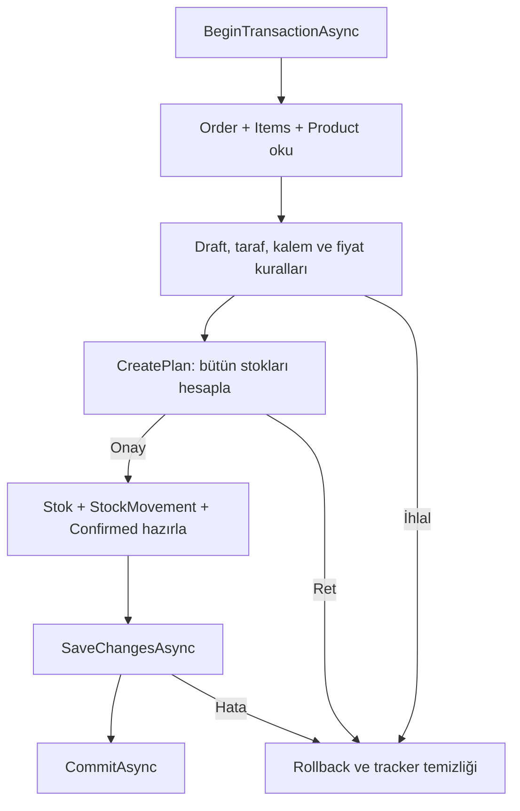

# StockFlow teknik şemaları

Şemalar iş modelini özetler. Düzenlenebilir şekiller sunumun 4, 7, 8 ve 9. slaytlarında, PNG karşılıkları Slayt_Gorselleri klasöründedir.

## Mimari

Tek uygulama host'u. Controller DbContext kullanmaz. Entity form girdisi değildir.

## Durum makinesi

Draft stok ve rezervasyon üretmez. Cancelled stok etkisi üretmez. Terminal durumlardan geri dönüş yoktur.

## İş ilişkileri

Order'ın en az bir kalem taşıması Service kuralıdır. Sale'de yalnız Customer, Purchase'da yalnız Supplier doludur. CreatedByUserId şemada nullable, yeni sipariş servisinde mevcut kullanıcı zorunludur. Identity destek tabloları gösterilmemiştir. OrderItem.UnitPrice geçmiş fiyatı taşır. OrderId + ProductId çifti benzersizdir.

## Atomik onay

Sale StockOut, Purchase StockIn üretir. Başarısız onay ilgili siparişi Draft bırakır ve kısmi değişiklik bırakmaz. Bu şema transaction sınırını gösterir. Eşzamanlı onayların tüm yarışları için ek strateji gerekir.
