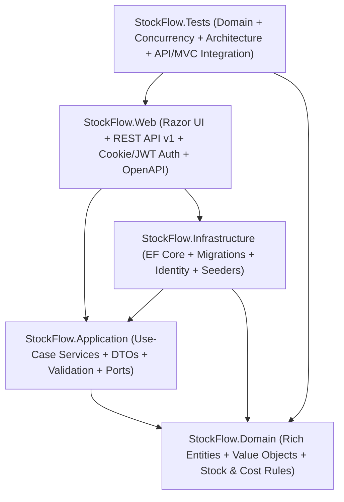

# StockFlow Portföy Dönüşüm Yol Haritası

Bu belge, 20 iş günlük staj MVP'sini güçlü bir **.NET Backend / Fullstack-Lite** portföy projesine dönüştürmek için yapılan tam kod tabanı incelemesinin bulgularını, kilitlenen stratejik kararları ve 7 fazlı tek uygulama yol haritasını içerir.

> **Yetki sınırı:** Hedef ürün davranışı için [product-spec.md](product-spec.md) normatif kalmaya devam eder. Bu yol haritası öneridir; kapsam [product-spec.md](product-spec.md) › 10.1 Faz kapıları ile açılır ([ADR-0004](adr/0004-product-spec-v2-phase-gated-scope.md)). Bir fazın maddeleri yalnız o faz orada `Açık` iken ve gereksinimleri spesifikasyona işlendikten sonra koda geçirilir.

---

## 1. Kilitlenen Stratejik Kararlar

| Karar Alanı | Seçilen Yön | Gerekçe |
| --- | --- | --- |
| **Hedef profil** | **.NET Backend / Fullstack-Lite** | Ana mühendislik ağırlığı veri bütünlüğü, eşzamanlılık, zengin domain modeli, REST API tasarımı, Testcontainers ve Docker'dadır. Ayrı SPA yerine mevcut Razor arayüzü API destekli modern bir yönetim paneline yükseltilir. |
| **Dil stratejisi** | **Şimdilik Türkçe** (kod sembolleri ve dosya adları İngilizce) | Arayüz, README, ürün sözleşmesi ve ADR'ler Türkçe tutarlılığını korur. Uluslararası başvuru ihtiyacı doğarsa Faz 6 sonrasında İngilizce README özeti eklenebilir. |
| **Mimari biçim** | **Yalın 4 projeli modüler monolit** (`Domain`, `Application`, `Infrastructure`, `Web`) | Bağımlılık yönü derleyici ve NetArchTest ile zorlanır. MediatR, CQRS ayrımı, Generic Repository/Unit of Work, AutoMapper ve mikroservis **eklenmez**; bu bilinçli tercih ADR ile belgelenir. |
| **Faz 3 domain kapsamı** | **4 çekirdek paketin tamamı** | *(1) Alış maliyeti / Ağırlıklı Ortalama Maliyet & Stok Değerlemesi, (2) Çoklu Depo & Atomik Transfer, (3) Audit kayıtlı Sayım/Düzeltme, (4) Onaylı Sipariş İadesi (Reversal) & Düşük Stoktan Otomatik Satın Alma Taslağı.* |
| **İleri opsiyonel kapsam** | **Stok Rezervasyonu & Depo İçi Lokasyon/Raf** | 4 çekirdek paket temiz tamamlandıktan sonra Faz 3.5 olarak açılabilir; çekirdek fazları bloklamaz. |

---

## 2. İnceleme Taban Çizgisi

- **Derleme (19 Kasım 2026):** `StockFlow` ve `StockFlow.Tests` 0 hata, toplam 4 uyarı ile derleniyor. Uyarıların tamamı `System.Security.Cryptography.Pkcs` `9.0.11` geçişli bağımlılığındaki **NU1902** (orta) ve **NU1903** (yüksek) güvenlik açığı bildirimleridir. Bu durum [CLAUDE.md](../CLAUDE.md) › Bilinen ortam gerçekleri bölümünde kayıtlıdır; uyarılar giderildiğinde orası da güncellenir.
- **Test tabanı:** 11 Kasım 2026 yerel LocalDB doğrulamasında 303 testin 303'ü geçmiş; ancak ilişkisel testler Windows LocalDB'ye bağımlı olduğundan çapraz platform/CI koşumu henüz yoktur.
- **Kod dağılımı (Migration hariç 12.181 satır):** `Services` 3.740, `Views` 3.231, `Controllers` 2.051, `wwwroot` 1.095, `Data` 944, `ViewModels` 678, `Entities` **166 satır**.
- **Test dağılımı (10.182 satır):** `Controllers` **4.098 satır** (103 metot / 155 vaka), `Services` 3.916 satır (85 metot), [OrderServiceTests.cs](../StockFlow.Tests/Services/OrderServiceTests.cs) yalnızca **11 test**.

### Korunması Gereken Güçlü Temeller

- Kaynak kodda sıfır secret/connection string; fail-fast [IdentitySeedOptions.cs](../StockFlow/Options/IdentitySeedOptions.cs), global auth fallback policy ([Program.cs](../StockFlow/Program.cs)), antiforgery, `Url.IsLocalUrl` kontrolü ve `lockoutOnFailure: true`.
- 11 SQL `CHECK` kısıtı, 3 benzersiz iş indeksi, bileşik sorgu indeksleri, `decimal(18,2)` ve her yerde `DeleteBehavior.Restrict`.
- Tek SQL transaction ve tek `SaveChangesAsync` ile atomik onay niyeti; bağımlılıksız [OrderStockConfirmationPlanner.cs](../StockFlow/Services/Orders/OrderStockConfirmationPlanner.cs); kategorili [ServiceResult.cs](../StockFlow/Services/Common/ServiceResult.cs) ve `TimeProvider` enjeksiyonu.
- EF Core InMemory yerine gerçek SQL Server üzerinde izole veritabanıyla çalışan test yaklaşımı.

---

## 3. Sunumda Alınan Eleştirilerin Nesnel Değerlendirmesi

| Eleştiri | Karar | Gerekçe |
| --- | --- | --- |
| **Katmanlar ayrı projeler olmalı** | **Kısmen haklı** | Proje sayısı tek başına kalite getirmez; asıl getirisi bağımlılık yönünün derleyiciyle zorlanmasıdır. Mevcut kodda **16 Service dosyası `StockFlow.ViewModels.*` kullanıyor** ve [ProductCreateInputModel.cs](../StockFlow/ViewModels/Products/ProductCreateInputModel.cs) üzerinden `Microsoft.AspNetCore.Mvc` iş katmanına sızıyor. |
| **Domain-spesifik değil** | **Tamamen haklı (en kritik bulgu)** | Sistem şu an stok sayaçlı genel bir CRUD düzeyinde. Çoklu depo, maliyet vs satış fiyatı, stok değerlemesi, sayım/düzeltme, fire, iade/ters kayıt ve yeniden sipariş önerisi yok; hatta satın alma siparişleri bile satış fiyatından işleniyor. |
| **Frontend zayıf** | **Haklı (görsellik değil, operasyonel UX zayıf)** | CSS tutarlı ve erişilebilir; ancak dashboard statik/tıklanamaz, grafik yok, sipariş formunda canlı stok/fiyat/toplam önizlemesi yok, stok hareketleri ham veritabanı ID'siyle filtreleniyor ve UI'a sınıf/enum adları sızıyor. |
| **MVC yerine API odaklı olmalı** | **Yarı haklı (yanlış çerçevelenmiş)** | MVC'yi çöpe atıp sadece JSON döndürmek backend'i güçlendirmez. Doğru olan: iş katmanını sunumdan ayırıp aynı `Application` çekirdeği üzerinde hem güçlü bir `/api/v1` REST API hem de o API'den beslenen modernleştirilmiş Razor arayüzü sunmaktır. |

---

## 4. Bağımsız Kod İncelemesi Bulguları (Öncelik Sırasıyla)

### 1. Sipariş Onayında Eşzamanlılık (Concurrency) ve SQL Kısıt Yarışları
- [OrderService.cs](../StockFlow/Services/Orders/OrderService.cs) (`ConfirmDraftAsync`) varsayılan `READ COMMITTED` izolasyon seviyesinde stoğu okuyup bellekte hesaplıyor ve mutlak değer olarak geri yazıyor. [Order.cs](../StockFlow/Entities/Order.cs) ve [Product.cs](../StockFlow/Entities/Product.cs) üzerinde `RowVersion`, concurrency token, `UPDLOCK` veya koşullu `UPDATE` yok.
- Aynı ürünü içeren iki satış siparişi eşzamanlı onaylanırsa **kayıp güncelleme (overselling)**; aynı taslak iki kez eşzamanlı onaylanırsa **çift stok düşüşü ve çift hareket** oluşur.
- [ProductService.cs](../StockFlow/Services/Products/ProductService.cs) SKU benzersizliğini önce `AnyAsync` ile kontrol edip sonra yazıyor; yarış durumunda SQL `2601`/`2627` hatası [TrackedPersistence.cs](../StockFlow/Services/Common/TrackedPersistence.cs) içinden yakalanmadan HTTP `500` olarak dönüyor. Aynı risk `DeleteAsync` FK `Restrict` (`547`) ihlallerinde de mevcut.
- Test paketinde eşzamanlı onay senaryosu yoktur.

### 2. Tek Fiyat Modeli Çelişkisi (Domain Hatası)
- [Product.cs](../StockFlow/Entities/Product.cs) yalnızca tek bir `Price` alanı taşır.
- [OrderService.cs](../StockFlow/Services/Orders/OrderService.cs) hem `Sale` hem `Purchase` siparişinde `Product.Price` değerini kopyalar; işletme tedarikçiden satış fiyatıyla mal alıyor görünür. Alış maliyeti, ağırlıklı ortalama maliyet, stok değerlemesi ve brüt kâr hesaplanamaz.

### 3. Stok Hareket Defteri Gerçeğin Kaynağı Değil
- Ürün açılış stoğu `StockMovement` üretmez ([ProductService.cs](../StockFlow/Services/Products/ProductService.cs)).
- [StockMovement.cs](../StockFlow/Entities/StockMovement.cs) üzerinde `OrderId` zorunlu FK'dır; açılış bakiyesi, sayım farkı, düzeltme, fire veya transfer kaydedilemez.
- Sonuç olarak `SUM(StockIn) - SUM(StockOut)` mevcut `Product.StockQuantity` değerini kanıtlayamaz.

### 4. İş Katmanının MVC Sunum Katmanına Ters Bağımlılığı
- 16 Service ve Interface dosyası doğrudan `StockFlow.ViewModels.*` tiplerine bağlıdır.
- [ProductCreateInputModel.cs](../StockFlow/ViewModels/Products/ProductCreateInputModel.cs) ve [ProductUpdateInputModel.cs](../StockFlow/ViewModels/Products/ProductUpdateInputModel.cs) üzerinde `using Microsoft.AspNetCore.Mvc;` ve `[ModelBinder(BinderType = typeof(TurkishDecimalModelBinder))]` bulunur.
- [TurkishDecimalModelBinder.cs](../StockFlow/ModelBinding/TurkishDecimalModelBinder.cs) hata mesajlarında `"Fiyat"` kelimesini sabit kodladığı için maliyet/tutar gibi başka `decimal` alanlarda yeniden kullanılamaz.

### 5. Anemik Domain Modeli, 950 Satırlık `OrderService` ve Tek `Order` Tablosu
- Tüm entity'ler (9 dosya, 166 satır) `public set` veri taşıyıcısıdır; kendi değişmezlerini korumaz.
- [OrderService.cs](../StockFlow/Services/Orders/OrderService.cs) **950 satır**dır; entity güvencesi olmadığı için kalıcı taslağı onay öncesi baştan doğrular (`ValidatePersistedDraftAsync`) ve taraf doğrulamasını iki kez yazar (`ValidateInputPartyAsync` / `ValidatePersistedPartyAsync`).
- [OrdersController.cs](../StockFlow/Controllers/OrdersController.cs) **605 satır** ve 6 bağımlılık taşır.
- `Sale` ve `Purchase` tek `Orders` tablosunda nullable `CustomerId`/`SupplierId` + check constraint ile tutulur; Faz 3'te alış maliyeti, mal kabul ve iade davranışları ayrışacağı için tek çatı mı yoksa ayrı aggregate/tablo mu olacağı ADR ile netleştirilmelidir.
- Sipariş numarası kullanıcıya gösterilen 32 karakterli hex GUID'dir (`Guid.NewGuid().ToString("N")`).

### 6. Hata Bağlamı, Ölçeklenebilirlik ve Tip Tutarsızlıkları
- [OrderStockConfirmationPlanner.cs](../StockFlow/Services/Orders/OrderStockConfirmationPlanner.cs) ilk yetersiz üründe durur; `OrderService` ise ürün/miktar bilgisini elinde tuttuğu hâlde kullanıcıya yalnızca genel bir cümle döner (hangi ürünün kaç adet eksik olduğu gizlenir).
- [ServiceResult.cs](../StockFlow/Services/Common/ServiceResult.cs) yalnızca tek `ServiceError` taşır; çok alanlı doğrulama hatalarını tek yanıtta döndüremez.
- [OrdersController.cs](../StockFlow/Controllers/OrdersController.cs) her form açılışında ve validasyon hatasında tüm `Customers`, `Suppliers` ve `Products` kayıtlarını HTML `<select>` içine basar; [order-draft-form.js](../StockFlow/wwwroot/js/order-draft-form.js) her satır eklemesinde tüm `<select>` düğümünü DOM'da klonlar.
- `ProductService.UpdateAsync` güncelleme sonrası yalnızca `CanDelete` için 2 ek `AnyAsync` sorgusu atar; ancak controller başarıda `RedirectToAction(Details)` yaparak dönen modeli atar.
- `StockMovementViewModel` UTC `DateTimeOffset` kullanırken `Order*` ve `Dashboard*` modelleri `DateTimeKind.Unspecified` dönen ham `DateTime` taşır; [StockMovementQueryService.cs](../StockFlow/Services/StockMovements/StockMovementQueryService.cs) bitiş tarihini `<= 23:59:59.9999999` yerine yarı-açık aralıkla (`< EndDate + 1 gün`) filtrelemelidir.

### 7. Sistematik Kod Tekrarı (DRY İhlalleri) ve Üç Katmanlı Doğrulama
- [CustomerService.cs](../StockFlow/Services/Customers/CustomerService.cs) (334 satır) ile [SupplierService.cs](../StockFlow/Services/Suppliers/SupplierService.cs) (334 satır) ve controller'ları (274 vs 273 satır) yapısal olarak neredeyse kopyadır.
- `UnexpectedFailure`, `NotFoundView`, `GetLocalReturnUrl` (6'şar controller) ve `CreateErrorViewModel` (7 controller) ayrı ayrı kopyalanmıştır.
- Aynı doğrulama kuralı DataAnnotations + Service `if` blokları + DB constraint'te tekrar eder; controller'lar `switch` ile hata kodunu form alan adına geri çevirir.
- Başarısız olamayan salt-okunur sorgular (`GetListAsync`, `GetSelectionOptionsAsync`, `DashboardService.GetAsync`) `ServiceResult` ile sarıldığı için ulaşılmaz 500 dalları ve yapay testler oluşur.
- 6 `Index.cshtml` dosyasında sayfalama işaretlemesi, 3 view'da `GetOrderStatusLabel`/`GetOrderTypeLabel`, [_Layout.cshtml](../StockFlow/Views/Shared/_Layout.cshtml) içinde 7 kez aktif menü kontrolü ve 6 ayrı `NotFound.cshtml` dosyası tekrar eder ([Shared/NotFound.cshtml](../StockFlow/Views/Shared/NotFound.cshtml) içinde sabit `"Kategori listesine dön"` linki kalmıştır).

### 8. Operasyonel UX Sızıntıları ve Eksik Yönetim Ekranları
- Arayüzde iç sınıf ve enum adları görünür: `_DraftFormFields.cshtml` içinde `OrderService`, `Orders/Confirm.cshtml` içinde `StockOut`/`StockIn`, `StockMovements/Index.cshtml` içinde `Product/Order`.
- [StockMovements/Index.cshtml](../StockFlow/Views/StockMovements/Index.cshtml) kullanıcıdan ürün/sipariş adı yerine ham veritabanı integer ID'si (`Örn. 17`) ister.
- [Home/Index.cshtml](../StockFlow/Views/Home/Index.cshtml) KPI kartları ve son sipariş satırları tıklanabilir değildir; [Home/Privacy.cshtml](../StockFlow/Views/Home/Privacy.cshtml) şablon artığı olarak kalmıştır.
- Uygulamada Admin'in çalışan hesabı ekleyebileceği, rol değiştirebileceği veya parolasını sıfırlayabileceği bir **Kullanıcı Yönetimi** ekranı yoktur.

### 9. Dengesiz Test Piramidi, DevOps ve Depo Hijyeni
- 4.098 satırlık stub controller testine karşılık çekirdek [OrderServiceTests.cs](../StockFlow.Tests/Services/OrderServiceTests.cs) yalnızca 11 testtir; eşzamanlılık, stok defteri mutabakatı ve mimari bağımlılık testi yoktur.
- CI, Docker ve Linux üzerinde çalışabilen ilişkisel test altyapısı yoktur; uygulama 4 manuel secret + manuel migration olmadan ayağa kalkmaz.
- Git'te takip edilen `docs/~$ockFlow_Proje_Tanitim_ve_Ozellikler.docx` Word geçici kilit dosyası, ~8 MB `docs/presentation/` ikili dosyaları ve `StockFlow/ApplicationDbContext.dgml` depoyu şişirir.
- [DemoDataCatalog.cs](../StockFlow/Data/DemoDataCatalog.cs) `"Kurgusal..."` ve `"Demo..."` önekleri kullanır; ekran görüntülerinde ürün gerçekçiliğini zayıflatır.
- Ajan bağlamı artık eski `AGENTS.md` / `docs/ai/` sistemi yerine [CLAUDE.md](../CLAUDE.md) ve `.claude/` altındaki kurallar, skill'ler, roller ve guardrail'lerle yönetilir ([ADR-0003](adr/0003-claude-code-agentic-layer.md)); ancak insan mühendisler için mimari ödünleşim ADR'leri, diyagramlar ve ekran görüntüleri hâlâ eksiktir.

---

## 5. Hedef Mimari

- `StockFlow.Domain`: Sıfır dış NuGet bağımlılığı; tüm invariant'lar, durum geçişleri, maliyet ve defter kuralları burada yaşar.
- `StockFlow.Application`: ASP.NET Core MVC ve EF Core'dan bağımsız uygulama servisleri ve DTO'lar; hem Razor UI hem `/api/v1` REST uçları aynı katmanı çağırır.
- `StockFlow.Infrastructure`: EF Core `ApplicationDbContext`, SQL Server concurrency/kilitleme, Identity ve migration'lar (anlamsız `IGenericRepository<T>` eklenmez).
- `StockFlow.Web`: İnce MVC Controller/ViewModel/Views, `/api/v1` REST Controller/Endpoints, `ProblemDetails`, hibrit Cookie + JWT auth ve Composition Root.

---

## 6. Uygulama Yol Haritası (7 Faz)

Her faz, önceki fazın tüm testleri yeşilken başlar. Kapsam veya mimari değiştikçe [product-spec.md](product-spec.md) ve ilgili ADR, davranış değiştikçe `.claude/rules/editing-discipline.md` › Dokümantasyon tablosundaki belgeler aynı değişiklik kümesinde güncellenir.

### Ajan sistemiyle uygulama

- **Yetki sırası:** Bu yol haritası normatif değildir. Bir fazın açtığı kapsam (4 proje, REST API, JWT, Docker vb.) `product-spec.md` › 10.1'de faz kapılıdır ve [CLAUDE.md](../CLAUDE.md) › Değişmez proje sınırları bu ayrımı izler. Faz yalnız insan onaylı PR ile `Açık` olur; fazın gereksinimleri ve etkilenen `.claude/rules/*` aynı değişiklik kümesinde güncellenir. Ajanlar faz kapılı bileşeni kapısı `Açık` olmadan veya yalnız "roadmap'te var" diye eklemez.
- **Teslim:** Her faz maddesi ayrı bir iş olarak `/deliver <madde>` ile yürür: `planner` `docs/designs/` altına tasarım yazar → insan onaylar → `data-` / `service-` / `web-implementer` kendi katmanını test-first uygular → ana oturum done gate'i (build + test + format) doğrular → `reviewer` taslak inceleme hazırlar → PR, merge insanda.
- **Kütüphane bakımı:** Bir faz yeni bir konvansiyon getirdiğinde (ör. RowVersion/409 eşlemesi, ProblemDetails) `/curate-knowledge <yol>` ile kural veya skill'e dönüştürülür. Rol kapsamlarını değiştiren yapısal fazlardan sonra `agentic-repo-setup` update mode'da yeniden çalıştırılır.
- **Onay gerektiren adımlar:** csproj/paket, `Program.cs`, `appsettings*.json`, `.github/workflows/**`, `scripts/*.ps1` ve `product-spec.md` değişiklikleri guard tarafından insan onayına bağlıdır; `dotnet ef database update|drop` ve `dotnet add package` da onay ister.

### Faz 0 — Zemin, Sözleşme v2, Depo Hijyeni ve CI/CD (1–2 gün)
- [product-spec.md](product-spec.md) **v2** güncellemesi (portföy kapsamını ve Faz 1–6 kapılarını resmen aç). Aynı değişiklikte [CLAUDE.md](../CLAUDE.md) › Değişmez proje sınırları / Asla yapma listesi ve kapsam dışı bileşenleri anan `.claude/rules/*` maddeleri v2'ye uyarlanır; guard `policy.json` içindeki gerekçeler gözden geçirilir (`/curate-knowledge`, code owner incelemesi).
- **4 gerçek mühendislik ADR'si:** *(1) Yalın 4 projeli mimari ve neden MediatR/Generic Repo kullanılmadığı, (2) Stok eşzamanlılık stratejisi, (3) `SaleOrder` vs `PurchaseOrder` model kararı, (4) Hibrit Cookie + JWT kimlik doğrulama.*
- `System.Security.Cryptography.Pkcs` NU1902/NU1903 güvenlik uyarılarının giderilmesi.
- Depo hijyeni: `docs/~$ockFlow_Proje_Tanitim_ve_Ozellikler.docx`, şablon artığı `HomeController.Privacy` / `Views/Home/Privacy.cshtml`, `StockFlow/ApplicationDbContext.dgml` ve ~8 MB `docs/presentation/` ikili dosyalarının temizlenmesi/arşivlenmesi.
- **Testcontainers (MSSQL)** entegrasyonu ile ilişkisel testlerin Linux üzerinde çalışır hâle getirilmesi + **GitHub Actions CI** workflow'u. Bu, LocalDB kararını değiştirdiği için [ADR-0002](adr/0002-isolated-localdb-test-databases.md) yerine geçen yeni bir ADR ile birlikte `.claude/rules/testing.md` ve CLAUDE.md › Bilinen ortam gerçekleri güncellenir.
- CI workflow'u build, test ve `dotnet format StockFlow.slnx --verify-no-changes --no-restore` yanında guard testlerini (`node .claude/hooks/agentic/test-guard.mjs`) ve repo hijyeni betiğini koşar. GitHub'da `main` için branch protection: PR zorunlu, CI zorunlu ve "Require review from Code Owners" (`.github/CODEOWNERS`).

**Bittiğinin kanıtı:** Her push/PR'da Ubuntu runner üzerinde 0 hata, 0 uyarı ve tüm testler yeşil; depo hijyeni, format ve guard testleri temiz; `main` branch protection etkin.

### Faz 1 — Çekirdek Veri Bütünlüğü, Eşzamanlılık ve Stok Defteri (3–4 gün)
- `Product` ve `Order` üzerine `RowVersion` (`IsRowVersion()`) eklenmesi; sipariş onayında deterministik ürün ID sırasıyla kilitleme / optimistic concurrency ve çakışmada güvenli `409 Conflict` dönüşü.
- SQL unique (`2601`/`2627`) ve FK (`547`) ihlallerinin HTTP `500` yerine tipli `Validation`/`BusinessRule` sonucuna eşlenmesi.
- `StockMovement.OrderId` alanının opsiyonel yapılması ve `StockMovementType` genişletilmesi (`OpeningBalance`, `PurchaseIn`, `SaleOut`, `AdjustmentIn`, `AdjustmentOut`, `ReturnIn`, `ReturnOut`, `TransferIn`, `TransferOut`).
- Yeni ürün açılış stoğunun `OpeningBalance` hareketi üretmesi.
- `OrderStockConfirmationPlanner`'ın ilk üründe durmak yerine **tüm yetersiz stok kalemlerini** (ürün adı, SKU, istenen, mevcut) raporlaması; `ServiceResult`'ın çoklu alan hatası taşıması.
- GUID yerine insan-okunur sıralı sipariş numaraları (`SO-2026-00001`, `PO-2026-00001`); tüm tarihlerde tutarlı UTC `DateTimeOffset` ve yarı-açık tarih filtresi (`< EndDate + 1 gün`).

- Stok defteri değişmezi, yeni hareket türleri ve 409 eşlemesi `.claude/rules/orders-stock.md`, `services.md` ve `web-layer.md` içine işlenir (bugünkü "StockMovement yalnız Confirm'de" kuralı `OpeningBalance` ile değişir).

**Bittiğinin kanıtı:** Paralel `Task.WhenAll` eşzamanlı onay testleri (overselling ve double-confirm imkânsız) + *"tüm ürünler için hareket net toplamı == mevcut stok"* değişmez testi.

### Faz 2 — Proje Ayrımı, Zengin Domain Modeli ve DRY Temizliği (4–5 gün)
- Çözümün `StockFlow.Domain`, `StockFlow.Application`, `StockFlow.Infrastructure` ve `StockFlow.Web` projelerine bölünmesi + **NetArchTest** bağımlılık yönü testleri.
- Service katmanından `StockFlow.ViewModels.*` bağımlılığının tamamen kaldırılması; saf `Application` Request/Response DTO'ları; `TurkishDecimalModelBinder`'ın yalnız `Web` katmanında ve alana-bağımsız mesajla tutulması.
- Zengin domain davranışları (`private set`, kontrollü factory/metotlar: `Order.CreateDraft`, `Order.ReplaceItems`, `Order.Confirm`, `Order.Cancel`, `Product.AdjustStock`, vb.) ile 950 satırlık `OrderService`'in ~200 satırlık ince uygulama orkestrasyonuna indirilmesi; `ValidatePersistedDraftAsync` ve çift taraf doğrulamasının kaldırılması.
- DRY temizliği: `AppControllerBase`, merkezi `ServiceResult -> IActionResult` eşleyicisi, tek `Pagination` ViewComponent/TagHelper, tek parametreli `Shared/NotFound.cshtml`, merkezi enum display yardımcıları, aktif menü TagHelper'ı; `ProductService.UpdateAsync`'teki boşa atılan `CanDelete` sorgularının ve başarısız olamayan sorgulardaki gereksiz `ServiceResult` sarmalayıcılarının temizlenmesi.
- 4.098 satırlık kırılgan controller stub testlerinin sadeleştirilip ağırlığın domain, eşzamanlılık ve gerçek HTTP entegrasyon testlerine kaydırılması.

- **Ajan sistemi güncellemesi:** Proje ayrımı rol kapsamlarını ve kural glob'larını geçersiz kılar. Ayrımla aynı değişiklik kümesinde `agentic-repo-setup` update mode'da çalıştırılır: implementer rolleri yeni projelere göre yeniden tanımlanır (ör. domain / application / infrastructure / web), `.claude/hooks/agentic/policy.json` yazma kapsamları ve korumalı yollar (taşınan migration dosyaları), `.claude/rules/*` `paths:` glob'ları, `add-management-slice` tarifi ve CLAUDE.md mimari tablosu güncellenir. Implementer'lar kapsamları dışında kalan taşımayı yapamayacağı için proje ayrımının kendisi ana oturumda insan onaylı adımlarla yürütülür.

**Bittiğinin kanıtı:** NetArchTest mimari kuralları yeşil; toplam kod tekrarı ciddi biçimde azalmış; mevcut davranışlarda sıfır regresyon; `agentic-repo-setup` doğrulayıcısı 0 hata ve guard testleri yeşil.

### Faz 3 — Gerçek Envanter Domain Derinliği: 4 Çekirdek Paket (5–7 gün)
1. **Alış Maliyeti, Ağırlıklı Ortalama Maliyet (MAC) ve Stok Değerlemesi:** `Product` üzerinde `UnitCost` (ağırlıklı ortalama maliyet) ve `SalePrice` (satış fiyatı) ayrımı. Purchase Order satırlarında gerçek tedarikçi alış birim maliyeti girilir; onayda MAC otomatik güncellenir; toplam envanter değeri ve satış brüt kâr marjı hesaplanır.
2. **Çoklu Depo (`Warehouse` & `WarehouseStock`) ve Atomik Transfer:** Stoklar depo bazında takip edilir; siparişler hedef/kaynak depo seçer; depolar arası transfer tek atomik transaction içinde `TransferOut` + `TransferIn` üretir.
3. **Audit Kayıtlı Stok Düzeltme & Sayım (`StockAdjustment` / `StockCount`):** Yetkili kullanıcı gerekçe kodu (`CycleCount`, `Damage`, `Shrinkage`, `Found`) ve açıklama ile stok sayım/düzeltme kaydı oluşturur; her değişiklik hareket defterine yazılır.
4. **Onaylı Sipariş İadesi (`Return / Reversal`) + Düşük Stoktan Otomatik Satın Alma Taslağı:** Onaylanmış siparişi bozmadan ters kayıtla kısmi/tam iade işleme (`ReturnIn`/`ReturnOut`) ve düşük stoklu ürünler için tedarikçiye göre gruplanmış tek tıkla Purchase Draft oluşturma.

> **Opsiyonel Faz 3.5 (4 çekirdek paket bittikten sonra):** Onaylı satış için **Stok Rezervasyonu** (`OnHand` / `Reserved` / `Available`) ve depo içi **Lokasyon/Raf (Bin)** takibi.

**Bittiğinin kanıtı:** Her domain kuralı için saf Domain unit testleri + çoklu depo, maliyet ve ters kayıt senaryoları için SQL Server atomiklik/defter mutabakat testleri.

### Faz 4 — Profesyonel REST API Katmanı (`/api/v1`) (3–4 gün)
- Aynı `StockFlow.Application` katmanı üzerine `/api/v1` REST uçları (Products, Categories, Warehouses, Transfers, Orders + Confirm/Cancel/Return, StockMovements, Adjustments, Dashboard Analytics).
- RFC 9457 **`ProblemDetails`** ile `ServiceError` kategorilerinin tutarlı HTTP eşlemesi (`400`, `404`, `409`, `412`, `422`).
- **Hibrit Kimlik Doğrulama:** MVC ekranları için Cookie, `/api/v1` için **JWT Bearer + Refresh Token** (policy scheme ile temiz ayrım).
- Kritik yazma uçlarında (`confirm`, `adjustments`, `transfers`, `returns`) **`Idempotency-Key`** desteği.
- Güncelleme/onay uçlarında `RowVersion` tabanlı **`ETag` / `If-Match`** optimistic concurrency (`412 Precondition Failed`).
- **OpenAPI + Scalar/Swagger UI** etkileşimli sözleşme dokümantasyonu ve **Rate Limiting**.

- API katmanı için `paths:` kapsamlı yeni bir `.claude/rules/` kuralı (ProblemDetails eşlemesi, JWT/Cookie ayrımı, idempotency, ETag) ve gerekirse ayrı bir API implementer rolü `/curate-knowledge` ile eklenir.

**Bittiğinin kanıtı:** Gerçek HTTP API entegrasyon testleri (JWT 401/403, ProblemDetails, idempotency tekrar koruması, `If-Match` çakışma testi).

### Faz 5 — Modern, Operasyonel Razor + API Hibrit Arayüz (4–6 gün)
- **Yerleşim & Yönetim:** Daraltılabilir yan menü (sidebar), breadcrumb, üst çubukta hızlı SKU/sipariş arama ve Admin için temel **Kullanıcı Yönetimi** ekranı (çalışan ekleme, rol/durum yönetimi, parola sıfırlama).
- **Etkileşimli Dashboard:** Tıklanabilir KPI kartları (düşük stok -> filtreli ürün listesi, toplam envanter değeri, aylık brüt kâr), Chart.js / ApexCharts ile **Satış vs Alış trendi**, **Depo/Kategori bazlı stok değeri** grafikleri ve **Düşük stok acil aksiyon widget'ı**.
- **API Destekli Akıllı Sipariş Formu:** Tüm DB'yi `<select>` içine gömmek yerine `/api/v1/products?search=...` üzerinden asenkron ürün/taraf araması; ürün seçilince **anlık depo stoğu, satış/alış birim fiyatı ve canlı satır/genel toplam önizlemesi**; onay ekranında kalem bazlı stok yeterlilik tablosu.
- **Kullanıcı Dostu Stok Defteri & Zaman Çizelgesi:** Ham ID yerine ürün/SKU/depo/sipariş no araması, ürün detayında gömülü hareket zaman çizelgesi ve stok değişim grafiği, CSV dışa aktarım.
- **UI & Demo Cilası:** `OrderService` / `StockOut` / `Product/Order` gibi teknik sızıntıların tamamının temizlenmesi; `"Kurgusal..."` / `"Demo..."` önekleri yerine gerçekçi sentetik demo işletme kataloğu (güvenli `@example.com` adresleri korunarak).

**Bittiğinin kanıtı:** Tüm akışların güncel ekran görüntüleri README'de yer alır; sınırsız `<select>` yüklemesi tamamen ortadan kalkmıştır.

### Faz 6 — Üretim Kalitesi, Gözlemlenebilirlik ve Portföy Vitrini (2–3 gün)
- **Tek Komutla Çalıştırma:** Multi-stage `Dockerfile` + `docker-compose.yml` (`stockflow-web` + `sqlserver` + otomatik geliştirme migration/demo seed profili) ile temiz makinede tek `docker compose up` komutuyla açılış.
- **Observability:** Serilog yapılandırılmış JSON logging, `CorrelationId` middleware, `/health/live` ve `/health/ready` health check uçları.
- **Portföy Vitrini:** Türkçe ana `README.md` içinde mimari diyagramlar, ekran görüntüleri / GIF akışları, *"Teknik Kararlar ve Ödünleşimler"* özeti (eşzamanlılık çözümü, stok defteri değişmezi, neden MediatR/Generic Repo seçilmediği) ve canlı demo / Swagger bağlantısı.

- `Dockerfile` ve `docker-compose.yml` dağıtım yapılandırmasıdır; eklendiklerinde guard `approvalPaths` listesine alınır, `docker compose` ile veri silen komutlar (`down -v`) `shell.ask` kuralına eklenir.

**Bittiğinin kanıtı:** Temiz bir makinede tek komutla ayağa kalkar; CI yeşil, health check'ler sağlıklı ve README portföy sunumuna hazırdır.
